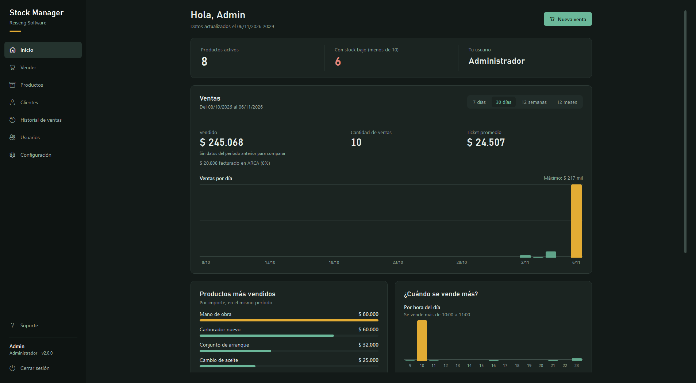
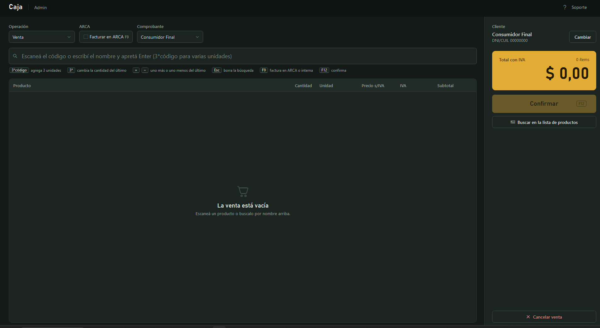
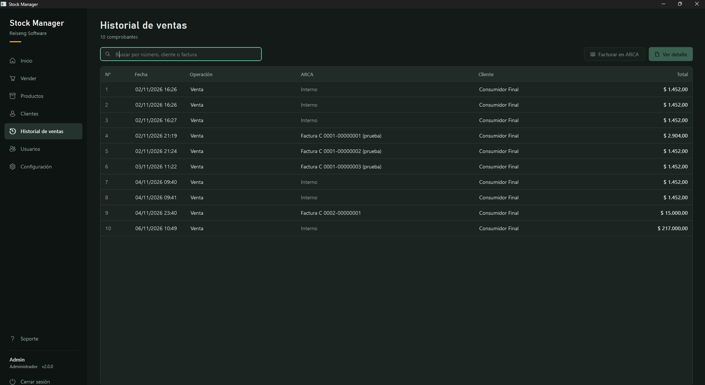
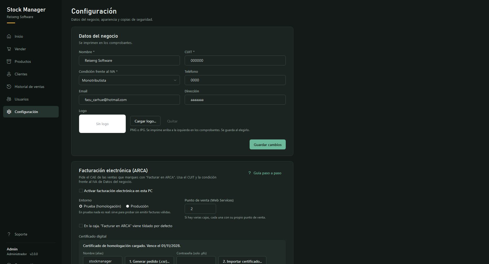
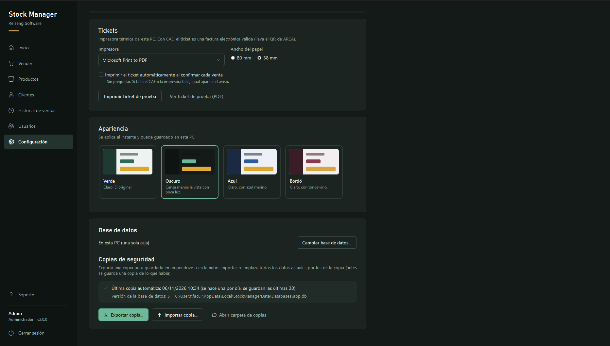

# Stock Manager

Desktop point-of-sale and inventory system for small businesses and small supermarkets in Argentina, built with C# and WPF (.NET 10).

It handles the full counter workflow: keyboard-driven sales, stock control, customers, ARCA electronic invoicing (optional, per sale), thermal tickets and sales statistics. It runs offline on a single PC (SQLite) or with several registers sharing a PostgreSQL server, and updates itself from GitHub Releases.

> The interface is in Spanish (es-AR), since it is designed for Argentine businesses.

---

## 📸 Screenshots

### Dashboard: sales at a glance
Sales by day, week or month, best-selling products, busiest hours and how much was invoiced in ARCA.



### Register
Built to be used without a mouse: scan or type, `3*code` for quantities, `F9` to invoice in ARCA, `F12` to confirm.



### Sales history
Every sale with its ARCA status. Internal sales can be invoiced later, and rejected ones resent.



### Settings
Business data and logo, ARCA electronic invoicing, ticket printer, themes, database and backups.





---

## 📌 Features

### 🛒 Sales
- Fast, keyboard-only register: barcode scanner, search by name, `3*code` for quantities, `+`/`−` to adjust, `F12` to confirm.
- Sales, budgets, credit notes and debit notes (credit notes are validated against the original sale).
- Stock is checked and updated in the same transaction as the sale: two registers can't sell the last unit at the same time.
- Products sold by unit, kilogram or liter.

### 🧾 ARCA electronic invoicing (optional)
- Requests the CAE through ARCA's web services (WSAA + WSFEv1), **only for the sales marked "Facturar en ARCA"**. The rest are recorded as internal vouchers.
- Factura A, B or C chosen automatically from the business and customer tax conditions.
- Works offline: sales are saved as "pending" and sent automatically when the connection comes back, without ever duplicating an invoice.
- Test (homologación) and production environments, each with its own certificate.
- The certificate request (`.csr`) is generated from the program. No OpenSSL needed.
- Step-by-step guide: [ARCA.md](ARCA.md).

### 🖨️ Vouchers and tickets
- A4 PDF with the Argentine voucher layout: letter, CAE, ARCA QR code and the Ley 27.743 tax transparency legend.
- 58 mm and 80 mm thermal tickets, printed directly or automatically after each sale.
- Business logo on vouchers and tickets.

### 📊 Statistics
- Sales by day, week or month, compared with the previous period.
- Best-selling products, busiest hours and days of the week.

### 📦 Inventory, customers and users
- Products with price, VAT rate and stock; low-stock indicator.
- Customers with their VAT condition.
- Users with roles (Administrator, Cashier and Stock clerk), hashed passwords and an optional "keep me signed in".

### 💾 Data
- **SQLite** on the PC (one register, works offline) or a **PostgreSQL** server (several registers). Chosen in a setup assistant on first run, and changeable later.
- Data can be moved from a PC to a server from the program itself.
- Automatic daily backup, plus manual export and import.
- Schema migrations run automatically, with a backup first.

### 🔄 Other
- Automatic updates from GitHub Releases (Velopack): the user decides when to install, and nothing breaks without internet.
- Four themes: Verde, Oscuro, Azul and Bordó.
- Support button with contact details.

---

## 🚀 Getting started

### Install
Download the installer from the [latest release](https://github.com/Reiseng/stock-manager-wpf/releases/latest) and run it. It includes everything (no .NET installation needed) and updates itself afterwards.

On first run, choose where to keep the data: **on this PC** (one register) or **on a PostgreSQL server** (several registers).

### Default credentials
A fresh database creates an administrator:

- User: `Admin`
- Password: `Admin123`

Change the password after the first login.

### Run from source
Requires the [.NET 10 SDK](https://dotnet.microsoft.com/download) on Windows.

```bash
git clone https://github.com/Reiseng/stock-manager-wpf.git
cd stock-manager-wpf
dotnet run
```

Or open `StockControl.sln` in Visual Studio and press `F5`.

### PostgreSQL for testing (Docker)

```bash
docker run -d --name stockmanager-db -e POSTGRES_PASSWORD=changeme -e POSTGRES_DB=stockmanager -p 5432:5432 -v stockmanager-data:/var/lib/postgresql/data postgres:16
```

Then, in the program: *Configuración → Base de datos → Cambiar base de datos…*, with server `localhost`, port `5432`, user `postgres`.

---

## 🛠️ Technologies

- C# / .NET 10 / WPF, MVVM
- Entity Framework Core 10 with SQLite and PostgreSQL (Npgsql)
- QuestPDF (vouchers and tickets) and QRCoder
- Velopack (installer and automatic updates)
- ARCA SOAP web services (WSAA, WSFEv1), CMS signing with `System.Security.Cryptography.Pkcs`
- Windows DPAPI to protect certificates, saved sessions and the server password
- GitHub Actions for releases

---

## 🧩 Project structure

```
Views/        WPF windows and views (XAML)
ViewModels/   MVVM view models
Services/     Business rules (sales, users, backups, statistics, tickets, updates)
Services/Arca ARCA electronic invoicing (fiscal rules, web service clients, certificates)
Data/         Data access with EF Core (one *Persistence class per entity)
Data/Ef       DbContext, table mappings and data transfer between engines
Models/ Dtos/ Domain models and DTOs
Themes/       Styles and color palettes
```

Data, configuration, certificates and logs are stored in `%LocalAppData%\StockManagerData`.

---

## 📄 License

[MIT](LICENSE). Free to use.

## 🤝 Support

Installation, ARCA setup, training and help with problems are offered as a paid service. Contact: **Facundo Reiseng**, facu_carhue@hotmail.com (the in-app *Soporte* button has the details).

Issues and pull requests are welcome.
