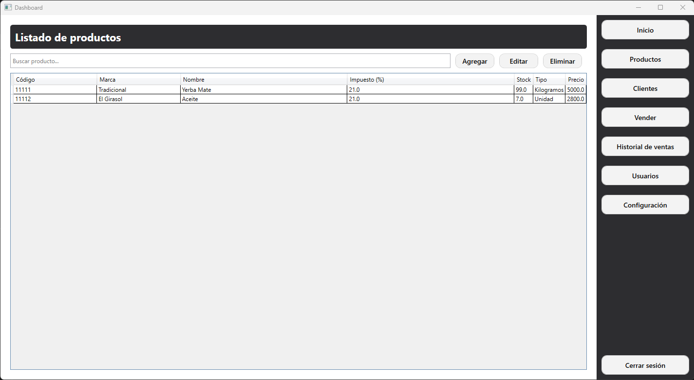
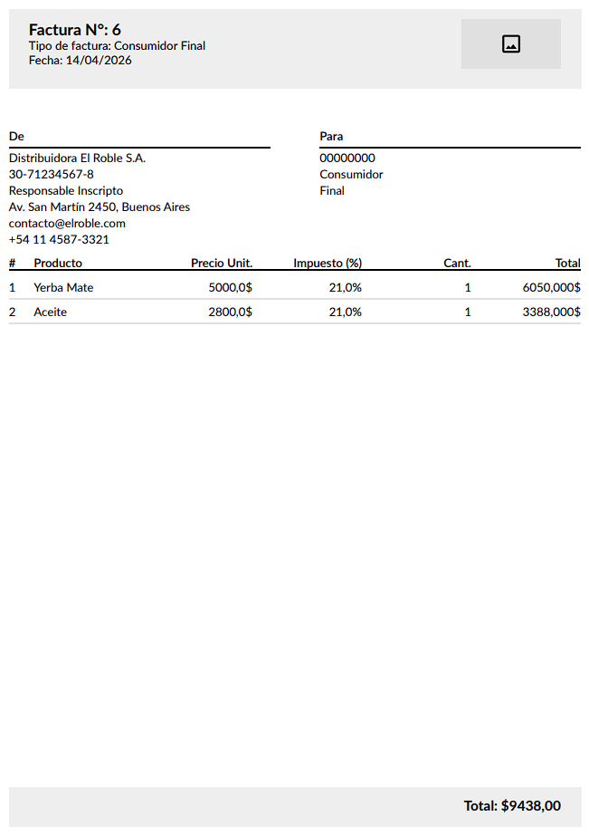
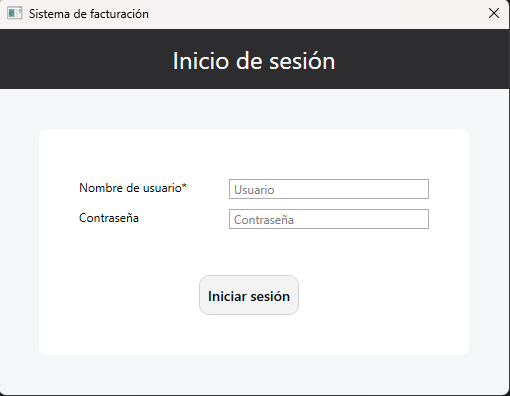

# StockControl - Inventory Management System (WPF)

Desktop application for stock management, sales operations, and basic business administration, developed in C# using WPF (.NET 10).

This project simulates a real-world system for small businesses, including inventory control, role-based access, and PDF generation.

---

## 📸 Screenshots

### 🏠 Dashboard

### 📦 Product Management

### 🧾 PDF Generation

### 🔐 Login

---

## 🛠️ Technologies Used

- C#
- .NET 10 (WPF)
- SQLite
- MVVM Pattern
- LINQ
- Layered Architecture
- Git

---

## 🔑 Default Credentials

On first run, the application automatically creates a default administrator account if no active admin exists.

- Username: Admin  
- Password: Admin123  

It is recommended to change the password after first login.

---

## 📌 Features

### 📦 Inventory Management
- Create, update and deactivate products  
- Stock validation (no negative values)  
- Price and tax management per product  

### 🧾 Sales & Operations
- Sales system  
- Credit Notes / Debit Notes  
- Budgets  
- Operation validation  
- PDF generation for transactions  

### 👥 Authentication & Roles
- Login system  
- Role-based access (Admin / Repository / Cashier)  
- Password hashing  
- Admin protection rules  

### 🏢 Business Configuration
- Company data management (name, contact info, etc.)  
- Dashboard with business information and stock summary  

### 💾 Data Persistence
- SQLite database  
- Automatic database initialization  
- Repository + Service architecture  

---

## 🧩 Architecture Overview

The application follows a layered architecture:

- UI Layer (WPF / MVVM)  
- Service Layer (business rules and validations)  
- Repository Layer (data access with SQLite)  

This structure improves scalability, maintainability, and separation of concerns.

---

## 🚀 How to Run

### Option 1 – Run from source
- Clone the repository  
- Open the solution in Visual Studio  
- Build and run  

### Option 2 – Download Release
- Download the latest release from the GitHub Releases section  

---

## 🔮 Future Improvements

- Advanced reporting module  
- Search and filtering improvements  
- UI/UX enhancements  
- Automated testing  
- Backup & restore system  

---

## 📚 Purpose of the Project

This project demonstrates:

- Desktop application development with WPF  
- MVVM architecture implementation  
- Business rule handling  
- Role-based security  
- Real-world inventory system design  

---

## 📄 License

MIT License.

---

## 🤝 Contributions

Contributions are welcome.  
Feel free to open issues or submit pull requests.